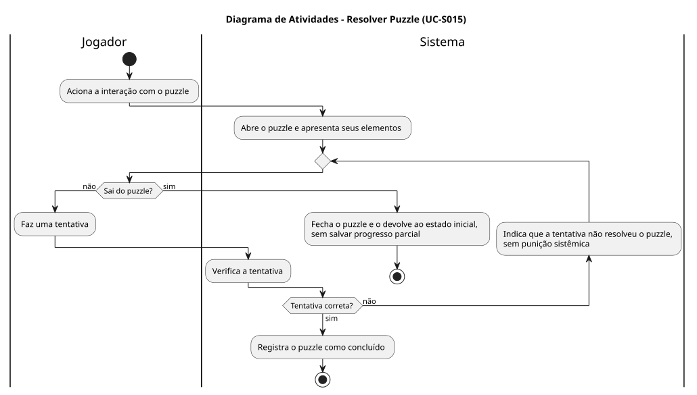
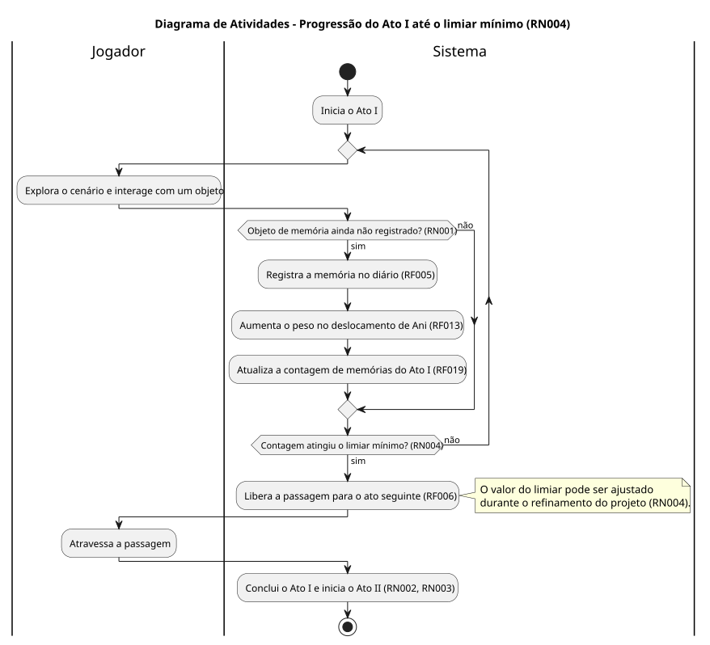
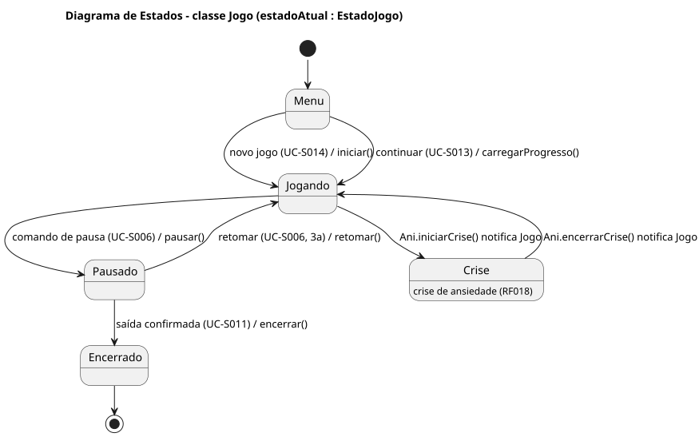

# Diagramas de atividades, estados e sequência

Diagramas UML do projeto **Ani אֲנִי** escritos em PlantUML. Cada diagrama tem o fonte (`.puml`) e o SVG renderizado ao lado. As seções correspondentes do TG estão no capítulo 2 do `tg-ani.md`.

Para renderizar de novo, com o `plantuml.jar` (versão usada: 1.2025.2):

```text
java -jar plantuml.jar -tsvg -charset UTF-8 docs/diagramas/*.puml
```

Os diagramas usam só classes e métodos do diagrama de classes (`docs/diagrama-de-classe/`). Onde falta um método, o diagrama indica isso em nota ou legenda, sem inventá-lo (correcoes-pendentes.md, item 60).

| Diagrama | Fonte | Imagem |
| --- | --- | --- |
| Atividades: Resolver Puzzle (UC-S015) | [atividades-resolver-puzzle.puml](atividades-resolver-puzzle.puml) |  |
| Atividades: Progressão do Ato I até o limiar mínimo (RN004) | [atividades-progressao-ato-i.puml](atividades-progressao-ato-i.puml) |  |
| Estados: classe Jogo | [estados-jogo.puml](estados-jogo.puml) |  |
