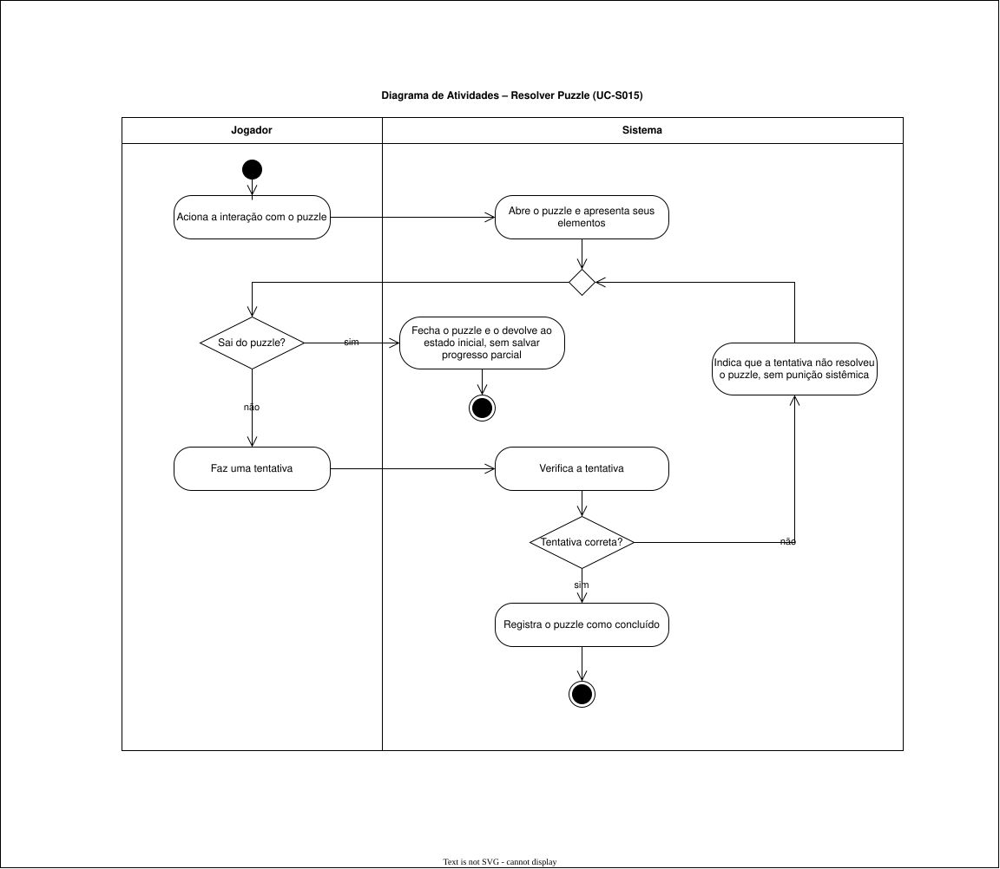
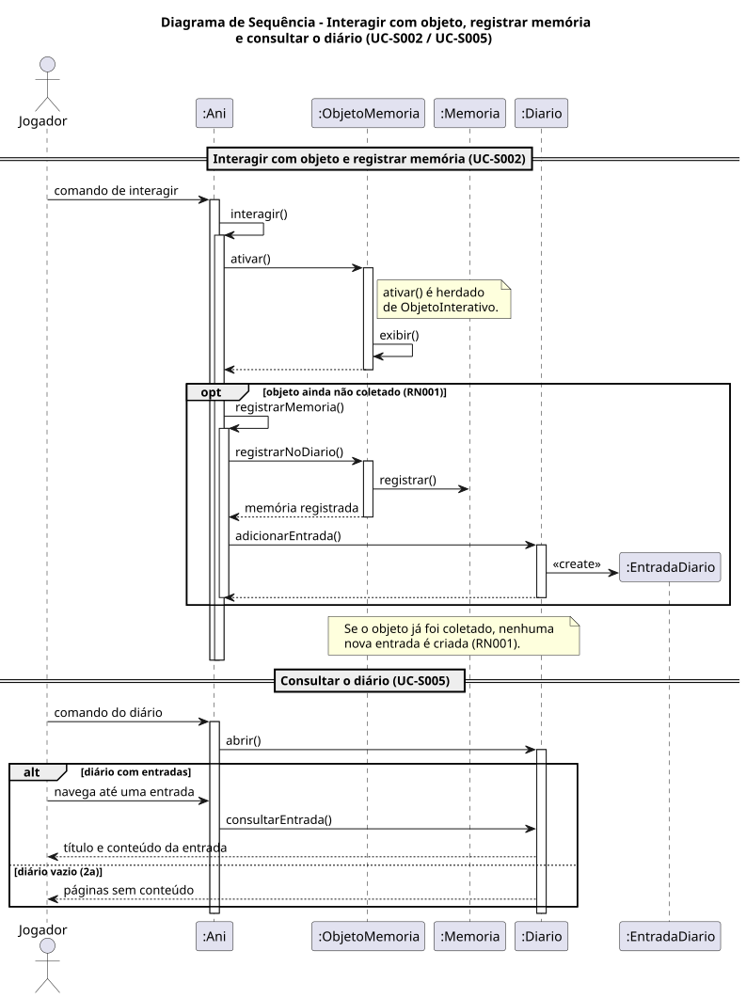
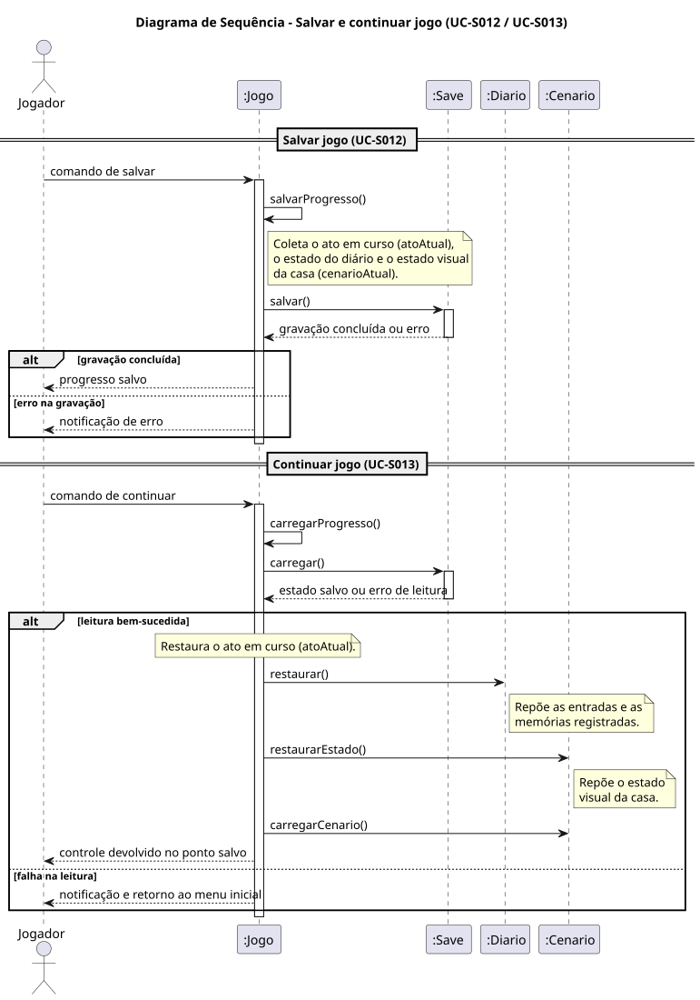

# Diagramas de atividades, estados e sequência

Diagramas UML do projeto **Ani אֲנִי** feitos no draw.io, no mesmo estilo dos diagramas de classes e de casos de uso. Cada diagrama tem o fonte (`.drawio`) e a imagem exportada (`.drawio.svg`) ao lado. As seções correspondentes do TG estão no capítulo 2 do `tg-ani.md`.

Para atualizar a imagem, abra o `.drawio` no draw.io (ou na extensão do VS Code) e exporte como `.drawio.svg` com o mesmo nome.

Os diagramas usam só classes e métodos do diagrama de classes (`docs/diagrama-de-classe/`). Os métodos que faltavam foram acrescentados ao diagrama de classes por decisão do autor (correcoes-pendentes.md, item 60).

| Diagrama | Fonte | Imagem |
| --- | --- | --- |
| Atividades: Resolver Puzzle (UC-S015) | [atividades-resolver-puzzle.drawio](atividades-resolver-puzzle.drawio) |  |
| Atividades: Progressão do Ato I até o limiar mínimo (RN004) | [atividades-progressao-ato-i.puml](atividades-progressao-ato-i.puml) |  |
| Estados: classe Jogo | [estados-jogo.puml](estados-jogo.puml) |  |
| Sequência: Interagir com objeto, registrar memória e consultar o diário (UC-S002 / UC-S005) | [sequencia-registrar-memoria.puml](sequencia-registrar-memoria.puml) |  |
| Sequência: Salvar e continuar jogo (UC-S012 / UC-S013) | [sequencia-salvar-continuar.puml](sequencia-salvar-continuar.puml) |  |
